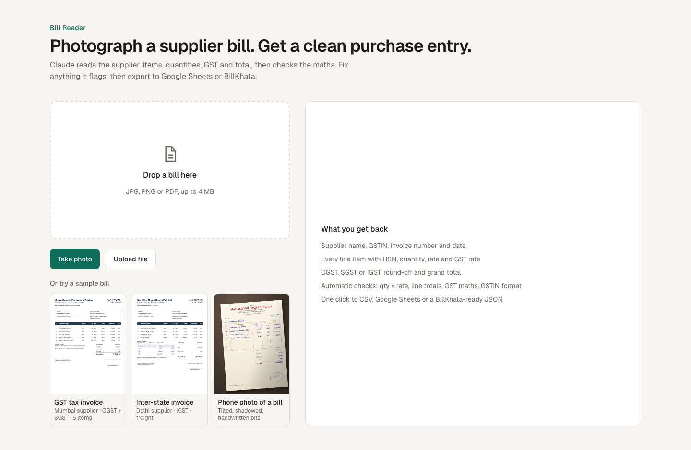

# Bill Reader

<!-- After deploying, add: **[Live demo](https://your-app.vercel.app)** · -->
Built with the Claude API, Next.js and TypeScript.



Photograph a supplier invoice. Claude pulls out the supplier, GSTIN, invoice number and date, every line item (HSN, quantity, rate, GST rate), CGST/SGST/IGST and the grand total. The app then checks the maths, lets you fix anything it flags, and sends the result to Google Sheets, a CSV, or a JSON file for BillKhata.

## Run it

```bash
npm install
cp .env.example .env.local   # then paste your ANTHROPIC_API_KEY
npm run dev
```

Open http://localhost:3000 and click one of the sample bills, or upload or photograph your own. On a phone, **Take photo** opens the camera.

## How it works

| Piece | File |
|---|---|
| What gets extracted (Zod schema → structured output) | `src/lib/schema.ts` |
| The Claude call: image or PDF in, validated JSON out | `src/lib/extract.ts` |
| Upload endpoint | `src/app/api/extract/route.ts` |
| Maths checks: qty × rate, line totals, GST at the stated rates, CGST = SGST, grand total, GSTIN format | `src/lib/checks.ts` |
| Spreadsheet rows and CSV | `src/lib/rows.ts` |
| Google Sheets endpoint | `src/app/api/sheets/route.ts` + `google-apps-script/Code.gs` |
| UI | `src/components/BillReader.tsx` |

- **Model:** `claude-opus-5-5` at `low` effort, for speed. If handwritten bills come back with misreads, set `BILL_READER_EFFORT=medium`.
- **Structured outputs:** the response is constrained to the schema, so no JSON-parsing fragility.
- **Refusal fallback:** turned on (`fallbacks: "default"`), so a false-positive safety decline is retried on a fallback model in the same call.
- **Phone photos** are shrunk to 2000 px in the browser before upload. The upload is faster and accuracy stays the same.

## Google Sheets (about 2 minutes, no Google Cloud project)

1. Open the target Google Sheet → **Extensions → Apps Script**, and paste in `google-apps-script/Code.gs`.
2. **Project Settings → Script properties:** add `SECRET` with any long random string.
3. **Deploy → New deployment → Web app.** Set "Execute as: Me" and "Who has access: Anyone".
4. In `.env.local`, set `GOOGLE_SHEETS_WEBHOOK_URL` to the web app URL and `GOOGLE_SHEETS_SECRET` to the same secret. Restart `npm run dev`.

Each bill is added to a `Purchases` tab, one row per line item, with the header repeated on every row. That layout makes SUMIF and pivot tables by supplier or HSN easy.

## BillKhata

**JSON for BillKhata** downloads the full extracted bill. To post directly into BillKhata, add a route next to `src/app/api/sheets/route.ts` that maps a `Bill` (see `schema.ts`) onto BillKhata's purchase-entry API.

## Measure accuracy and speed

`scripts/expected/` holds the correct values for each sample bill. With the dev server running:

```bash
npm run eval
```

The script runs each sample through the real API and prints how many fields matched and the time each bill took. Use these numbers for the "seconds per bill" line on your portfolio, and add a few of your real supplier bills (with their expected JSON) for numbers that mean something. Each run makes one API call per bill.

`npm run samples` regenerates the sample images (needs Google Chrome). All businesses and GSTINs in them are made up.

## Deploy (Vercel)

1. Go to [vercel.com/new](https://vercel.com/new) and import this GitHub repo. The defaults are right for Next.js.
2. Under **Environment Variables**, add:
   - `ANTHROPIC_API_KEY`: your key
   - `DEMO_PASSCODE`: any word you'll share with people you want to try their own bills
   - optionally the two `GOOGLE_SHEETS_*` values
3. Deploy. The extract route allows up to 60 s (`maxDuration`).

### Public demo protection

With `DEMO_PASSCODE` set, anyone can run the three sample bills. Their results are cached on each server, so repeat clicks don't cost API credits. Reading your own bill, or sending to Google Sheets, needs the passcode. Leave it unset locally and nothing is locked.

The bypass recognises the sample files by their SHA-256 hash (`src/lib/sample-hashes.json`, regenerated by `npm run samples`).

## Portfolio

`portfolio/` holds a project card (`project-card.html`) and a case study page (`case-study.html`) for your own website, with images in `portfolio/images/`. Both are self-contained HTML and CSS. Replace the `YOUR-DEMO` link once deployed, and fill the bracketed results with numbers from `npm run eval`.
